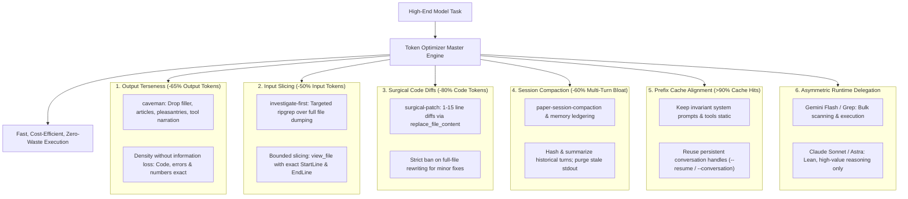

# Token Optimizer: Unified Token & Context Minimization Suite

The **Token Optimizer** integrates six synchronized token reduction technologies into a single operational protocol designed specifically to make high-end model runs (Claude 3.5/3.7 Sonnet, Opus 4, GPT-6 Astra, Gemini 3.1 Pro) dramatically faster, cheaper, and resistant to context degradation.

---

## When to Activate

Activate this skill automatically whenever:
- The user requests token optimization ("token optimizer", "minimize tokens", "less tokens", "reduce cost", "/tok-opt")
- High-end models (Claude Sonnet/Opus, Astra, Gemini Pro) are executing complex, multi-turn tasks
- Context length approaches 50% of the model window or multi-agent delegation loops run repeatedly
- In conjunction with `/maestro` and `paper-writer`

---

## The 6 Core Optimization Protocols

---

### Protocol 1: Terse Caveman Density & Review Format (Output Compression: -65%)
*Powered by `caveman`, `caveman-compress` & `caveman-review`*
- **Drop**: Articles (*a/an/the*), conversational filler (*just/really/basically/actually/simply*), pleasantries (*sure/certainly/happy to*), hedging, and repetitive preambles.
- **Never Drop**: Logical operators (*not/never/no/only/except*), exact variable names, line numbers, file paths, and code snippets.
- **Terse Findings & Review Format**: Exactly one line per finding without throat-clearing:
  `L<line>: <severity> <problem>. <concrete fix>.` (or `<file>:L<line>: ...` for multi-file diffs).
- **Severity Prefixes**:
  - `🔴 bug:` — broken behavior, runtime exception, incident-causing defect.
  - `🟡 risk:` — fragile code (race condition, missing null check, swallowed error, unhandled edge case).
  - `🔵 nit:` — style, naming, micro-optimization. Author can ignore.
  - `❓ q:` — genuine question requiring user clarification.
- **Tool calls**: Fire directly. Never output conversational narration before or after a tool call unless explaining an irreversible or security-critical action.

### Protocol 2: Input Context Slicing & AST Routing (Input Reduction: -50% to -70%)
*Powered by `investigate-first` & `graphify`*
- **Never** call `view_file` on an entire 500+ line file to find one function.
- **AST Knowledge Graph First**: When navigating dependencies across files, run `graphify query "<symbol>"` to pinpoint callers, callees, and exact line numbers. Refresh the graph locally via `graphify extract . --code-only` after structural modifications.
- **Anti-Bloat Guardrail**: STRICT BAN on viewing, catting, or dumping `graphify-out/graph.json` or `GRAPH_REPORT.md` whole into context (prevents 10k–50k token context flooding). Only query targeted symbols.
- Always run `grep_search` or `find_by_name` first to obtain exact line ranges.
- Slice `view_file` strictly to the relevant 20–60 lines (`StartLine` and `EndLine`).
- When running commands that produce huge output (e.g. `git log`, `test`), cap output or pipe through `head -n 20` or `tail -n 20`.

### Protocol 3: Surgical Diff Patching & Minimal Code (Code Reduction: -80%)
*Powered by `surgical-patch` & `ponytail`*
- **The Ponytail YAGNI Ladder**:
  1. *Existence Check*: Does this code, wrapper, or feature need to exist? If not, skip it.
  2. *Standard Library First*: Reach for built-in language/runtime tools before installing packages.
  3. *Native Platform First*: Reach for native platform/language features before third-party wrappers.
  4. *Reuse Existing Code*: Leverage abstractions already in the project before creating new ones.
  5. *Minimal Implementation*: Write the absolute minimum lines of code required.
- **Anti-Bloat Guardrail**: Apply Ponytail SILENTLY in code. STRICT BAN on explaining or narrating the ladder steps in chat (prevents output token ballooning).
- **Strictly prohibit** overwriting entire existing files with `write_to_file` when fixing bugs.
- Always use `replace_file_content` targeting the minimal contiguous block (1–15 lines).
- Every patch must trace directly to a verified `🔴 bug:` or `🟡 risk:`.
- 100% Safety Guarantee: Maintain all validation boundaries, error handling, security checks, and invariants.

### Protocol 4: Session Compaction & Digesting
*Powered by `session-management` & `paper-session-compaction`*
- In conversations spanning more than 10 turns, compact previous turns into dense, telegraphic session state files (`docs/maestro/state/digest.md`).
- Discard raw intermediate terminal scrollbacks, keeping only final outcomes, return codes, and verified invariants.

### Protocol 5: Prompt Prefix Cache Optimization
- Ensure invariant context (system rules, tool schemas, project metadata) remains bit-identical at the start of prompts to leverage Anthropic and Google prefix caching (up to 90% discount on cached input tokens).
- Maintain persistent session IDs (`--conversation` in Gemini, `--resume` in Claude Code) across phases to hit cached memory.

### Protocol 6: Asymmetric Runtime Routing
- Route high-volume, repetitive, or bulk operations (file crawling, large regex grep, simulation runs, test suite executions) to **Gemini Flash** or local shell commands.
- Dispatch only dense, high-signal packets to high-end models (**Claude Sonnet/Opus**, **GPT-6 Astra**) for design decisions, mathematical verification, and code review.
